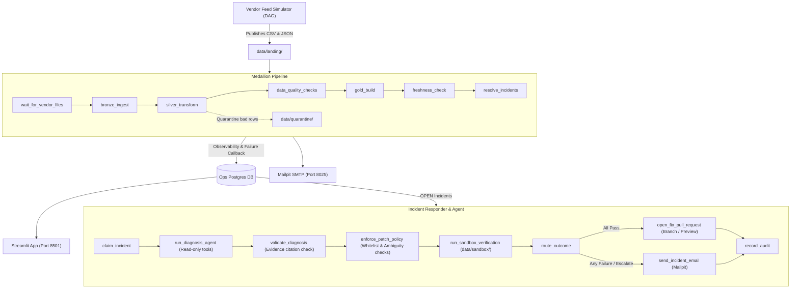
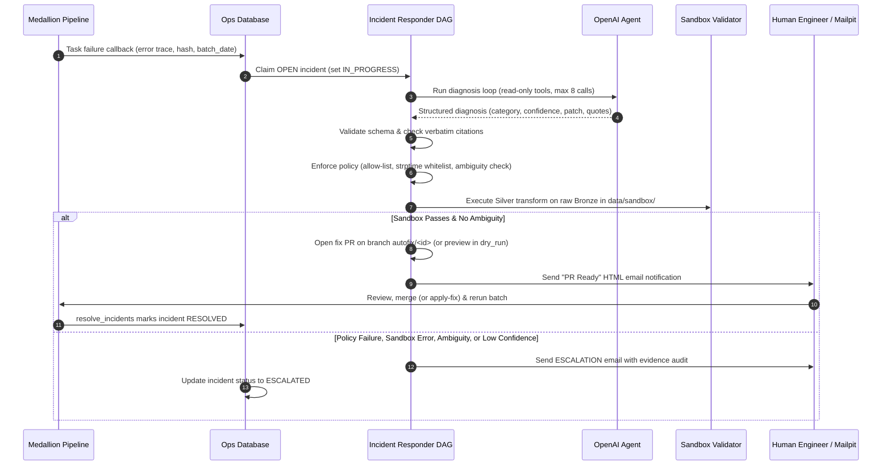

# PipelineSentinel

> **A self-healing medallion data pipeline on Delta Lake with a guardrailed AI incident responder.**

[](.github/workflows/ci.yml)
[](https://www.python.org/)
[](https://airflow.apache.org/)
[](https://delta.io/)
[](https://streamlit.io/)

A daily Airflow pipeline (Bronze, Silver, Gold on Delta Lake) absorbs transient failures with exponential backoff retries and timeouts. When that is not enough, an OpenAI tool-calling agent diagnoses the failure from logs and data profiles, then either opens a sandbox-verified fix pull request on a new branch or emails the engineer a full audit. The agent can never merge, never run pipeline actions, and can only propose one structured edit to one allow-listed rules file. A multi-page Streamlit app shows the backend stages live (Airflow "Task Instances" style), business dashboards, and incident post-mortems.

---

## 1. UI Preview

```
+---------------------------------------------------------------------------------------------------+
|  [🛡️ Live Run Monitor]  [💰 Revenue Dashboard]  [🏥 Pipeline Health]  [🔍 Incident Audit]  [🎛️ Demo]  |
+---------------------------------------------------------------------------------------------------+
|  DAG: orders_medallion_daily | Run: manual__2026-10-01 | Status: ✅ Success (7/7 tasks completed)   |
|  [======================================================================================] 100%    |
|                                                                                                   |
|  [wait_for_vendor] -> [bronze_ingest] -> [silver_transform] -> [data_quality] -> [gold_build]   |
|       (green)              (green)            (green)              (green)          (green)       |
+---------------------------------------------------------------------------------------------------+
```

---

## 2. Why This Project?

Data engineering teams face the **2 AM pipeline failure problem**:
1. An upstream vendor silently shifts order dates from `YYYY-MM-DD` to `DD/MM/YYYY`, or aliases `amount` to `total_amount`.
2. A strict production schema validation or date parser crashes the batch.
3. An on-call engineer is paged at 2:00 AM, wakes up, greps logs for 45 minutes, adds a format pattern or column alias to a YAML file, runs local unit tests, pushes a branch, opens a PR, merges, and triggers a manual rerun.

**What PipelineSentinel Demonstrates:**
- **Transient Resiliency:** Network glitches and transient auth failures are absorbed automatically by Airflow's backoff retries without paging humans.
- **Deterministic AI Diagnostics:** For deterministic drift, an OpenAI agent uses 7 strictly read-only inspection tools to cite verbatim error logs and column profiles.
- **Isolated Sandbox Verification:** Proposed rules edits are compiled and executed in a dedicated sandbox environment against raw data to verify row count conservation, schema compliance, and revenue reconciliation before any PR is created.
- **Absolute Guardrails:** Code decides routing, not the LLM. The agent cannot write to production tables, cannot merge PRs, cannot push to `main`, and can only propose `append_unique` edits to `config/silver_rules.yml`. If any ambiguity exists, it fails safe to human escalation.

---

## 3. Architecture & Core Principles

### System Architecture


### Incident Response Sequence


### Failure Routing Matrix

| Failure Scenario | Layer | Detection & Error Class | Responder Routing | End State |
| :--- | :--- | :--- | :--- | :--- |
| `none` | Medallion | Clean execution | No incident created | All tasks green, Gold updated |
| `transient_error` | Bronze | `RetryablePipelineError` | Handled by Airflow retry | Try 2 succeeds automatically, no incident |
| `date_format` | Silver | `FormatDriftError` (unparseable ratio > limit) | Category `format_drift`, sandbox verifies | Fix PR opened (or dry-run preview), email sent, resolves on rerun |
| `column_rename` | Silver | `MissingColumnError` (missing required col) | Category `schema_drift`, alias patch | Alias PR opened (or preview), email sent, resolves on rerun |
| `null_spike` | DQ | `DataQualityError` (null rate > threshold) | Category `data_quality`, no patch allowed | Fail-safe human escalation email |
| `ambiguous_date` | Silver | `FormatDriftError` (ambiguous day/month) | `ambiguous_day_month_share > 0` blocks patch | Fail-safe human escalation email |
| `auth_error` | Bronze | `AuthError` (deterministic bad credential) | Immediate non-retryable task failure | Infrastructure escalation email |
| `missing_file` | Sensor | `AirflowSensorTimeout` (120s timeout) | Sensor timeout triggers failure callback | Late data escalation email |

### Core Design Principles
1. **The LLM Has No Write Access:** All agent inspection tools are strictly read-only. Database writes, branch creations, and email notifications exist only in deterministic Python code that the model cannot invoke.
2. **Code Decides Routing, Not the LLM:** Pydantic schema validation, verbatim citation checking, patch policy grammar, and sandbox execution decide whether a PR is opened or an issue is escalated.
3. **Fail-Safe Default:** Any missing API keys, request timeouts, schema rejections, policy violations, or sandbox failures automatically force human escalation by email.
4. **Humans Merge PRs:** The agent creates isolated branches named `autofix/<incident_id>-<slug>` and opens a PR. It never touches `main` and never merges.
5. **Single Allow-Listed Target:** The agent can only propose `append_unique` edits to `config/silver_rules.yml`. No other file in the repository can ever be modified by the agent.

---

## 4. Tech Stack

| Component | Pinned Version | Purpose |
| :--- | :--- | :--- |
| **Apache Airflow** | `3.4.0` | Orchestration with `LocalExecutor`, sensor timeouts, failure callbacks |
| **Apache Spark / PySpark** | `3.5.4` | In-memory distributed data processing (tuned local mode) |
| **Delta Lake** | `3.3.0` | ACID storage, time travel, idempotent upserts via `replaceWhere` |
| **Delta-RS (`deltalake`)** | `0.25.1` / `1.6.6` | Rust-based zero-JVM Delta table reader for Streamlit |
| **PostgreSQL** | `16-alpine` | Dual-database: Airflow metadata DB (`airflow`) & Ops observability DB (`ops`) |
| **OpenAI SDK** | `1.65.1` | Function-calling autonomous incident diagnosis agent (`gpt-4o`) |
| **Streamlit** | `1.42.0` | 5-page real-time operational monitor and business dashboard |
| **Mailpit** | `v1.21.8` | Local SMTP email testing sink with web UI |
| **PyGithub** | `2.5.0` | Deterministic pull request generation |
| **Docker Compose** | `v2.35+` | Containerized orchestration across 7 services |

---

## 5. Prerequisites

- **Docker Desktop:** Version 26+ with at least **6GB to 8GB of RAM** allocated (Settings -> Resources -> Memory).
- **Git:** Version 2.40+.
- **Python 3.12 or 3.13:** Optional for local development/linting (the full stack runs in Docker).
- **Make:** Standard on Linux/macOS. On Windows, use PowerShell equivalents or install make via Chocolatey (`choco install make`).
- **OpenAI API Key:** For autonomous agent diagnosis (e.g. `OPENAI_API_KEY=sk-...`). If omitted, the agent safely falls back to escalation by design.

---

## 6. Quickstart

### Step 1: Clone and Configure
```powershell
# Clone repository
git clone https://github.com/your-org/pipeline-sentinel.git
cd pipeline-sentinel

# Copy environment template
cp .env.example .env
```
Edit `.env` to set your `OPENAI_API_KEY`:
```ini
OPENAI_API_KEY=sk-your-openai-key-here
OPENAI_MODEL=gpt-4o
PR_MODE=dry_run
```

### Step 2: Start All Services
```powershell
# Using Make:
make up

# PowerShell Equivalent:
docker compose up -d
```
*Wait ~45 seconds for all 7 containers to become healthy.*

### Step 3: Seed Historical Data (30 Batches)
```powershell
# Using Make:
make seed

# PowerShell Equivalent:
docker compose exec airflow-scheduler python -m simulator.generate_history
```
*Generates 150,000 synthetic orders across 30 batch dates in `data/source_archive/`.*

### Step 4: Access Web Interfaces
- **Streamlit Dashboard:** [http://localhost:8501](http://localhost:8501)
- **Airflow Web UI:** [http://localhost:8080](http://localhost:8080) (Username: `airflow`, Password: `airflow`)
- **Mailpit Web UI:** [http://localhost:8025](http://localhost:8025)

---

## 7. Streamlit UI Tour

The multi-page application runs on port `8501`:

1. **Live Run Monitor (`1_Live_Run_Monitor.py`):**
   - Airflow **Task Instances** style view.
   - Status header: `Running: <task> (try N)` or `Success: <dag> (all tasks completed)`.
   - Real-time progress bar and **Graphviz pipeline stage graph** with nodes colored by execution state (green success, red failed, blue running, grey queued).
   - Filterable Task Instances table with state badge pills, task search, and state dropdown.
   - Tabs for Task Instances, Errors (exception excerpts), and Logs (`pipeline_log` table with level filters).
   - Auto-refresh toggle updating stages every 4 seconds.
2. **Revenue Dashboard (`2_Revenue_Dashboard.py`):**
   - Executive KPIs: Total Revenue, Total Orders, Average Order Value, and Last Gold Refresh.
   - Revenue by day line chart and revenue by channel bar chart.
   - Daily revenue and customer lifetime value breakdown tables queried directly from Gold Delta tables without JVM overhead.
3. **Pipeline Health (`3_Pipeline_Health.py`):**
   - Run reliability metrics: Total Executions, Success Rate %, Resolved by Retry counter, and Quarantine counts.
   - Task execution duration trends over time.
   - Data Quality check pass/fail rate breakdowns.
4. **Incident Audit (`4_Incident_Audit.py`):**
   - Filterable list of all production incidents.
   - Full post-mortem inspector: raw task exceptions, agent root-cause diagnosis, verbatim evidence citations with validation status, proposed patch diff, isolated sandbox verification metrics, agent tool-call timeline, and token economics.
5. **Demo Control (`5_Demo_Control.py`):**
   - Interactive failure scenario injector.
   - Dropdown of all 8 failure modes and batch date selector.
   - Writes `demo_config` in Ops Postgres and generates the exact copy-pasteable PowerShell execution commands.

---

## 8. Demo Script & Verification Walkthrough

Run each scenario using either `make demo` or PowerShell:

### Scenario 1: Baseline Healthy Run (`none`)
```powershell
docker compose exec airflow-scheduler python -m simulator.publish_batch --failure=none --batch-date=2026-10-01
docker compose exec airflow-scheduler airflow dags trigger orders_medallion_daily --conf '{"batch_date": "2026-10-01"}'
```
- **What to observe:** Airflow executes all 7 tasks to `success`. Streamlit Live Run Monitor displays a green pipeline graph. Gold tables are refreshed. No incidents are created.

### Scenario 2: Transient Network Glitch (`transient_error`)
```powershell
docker compose exec airflow-scheduler python -m simulator.publish_batch --failure=none --batch-date=2026-10-02
docker compose exec airflow-scheduler python -m simulator.publish_batch --record-config=transient_error --batch-date=2026-10-02
docker compose exec airflow-scheduler airflow dags trigger orders_medallion_daily --conf '{"batch_date": "2026-10-02"}'
```
- **What to observe:** `bronze_ingest` fails on Try 1 with `RetryablePipelineError`, pauses for exponential backoff, then succeeds automatically on Try 2. No incident is created. Streamlit Pipeline Health increments the "Resolved by Retry" counter.

### Scenario 3: Date Format Drift & Autofix (`date_format`)
```powershell
docker compose exec airflow-scheduler python -m simulator.publish_batch --failure=date_format --batch-date=2026-10-03
docker compose exec airflow-scheduler airflow dags trigger orders_medallion_daily --conf '{"batch_date": "2026-10-03"}'
```
- **What to observe:**
  1. `silver_transform` fails immediately (`FormatDriftError`).
  2. Failure callback records incident `INC-2026-10-03-silver_transform-...` in Ops DB.
  3. The `incident_responder` DAG claims the incident, inspects error logs and column profiles, and proposes `append_unique` value `%d/%m/%Y`.
  4. Sandbox verifies the patch against raw Bronze data in `data/sandbox/<id>/` (verifying 0 unparseable rows, row conservation, and revenue reconciliation).
  5. PR preview is written to `data/pr_previews/<incident_id>.md` and an HTML notification email appears in Mailpit (`http://localhost:8025`).
  6. **Simulate human merge and rerun:**
     ```powershell
     python -m responder.patcher --incident-id <INCIDENT_ID>
     docker compose exec airflow-scheduler airflow dags trigger orders_medallion_daily --conf '{"batch_date": "2026-10-03"}'
     ```
  7. On rerun, `silver_transform` succeeds, Gold is updated, and `resolve_incidents` marks the incident `RESOLVED`.

### Scenario 4: Ambiguous Dates (`ambiguous_date`)
```powershell
docker compose exec airflow-scheduler python -m simulator.publish_batch --failure=ambiguous_date --batch-date=2026-10-04
docker compose exec airflow-scheduler airflow dags trigger orders_medallion_daily --conf '{"batch_date": "2026-10-04"}'
```
- **What to observe:** Silver fails. The agent analyzes the column profile and discovers `ambiguous_day_month_share > 0` (e.g. `05/10/2026`). The ambiguity guardrail blocks patch proposal and routes directly to human escalation. Mailpit receives an `[ESCALATION]` email.

### Scenario 5: Data Quality Null Spike (`null_spike`)
```powershell
docker compose exec airflow-scheduler python -m simulator.publish_batch --failure=null_spike --batch-date=2026-10-05
docker compose exec airflow-scheduler airflow dags trigger orders_medallion_daily --conf '{"batch_date": "2026-10-05"}'
```
- **What to observe:** `data_quality_checks` detects customer_id null rate > 25%, failing the task and halting Gold build. The agent identifies root cause `data_quality` and dispatches an escalation email.

---

## 9. How the Pipeline Works

```
Landing (CSV/JSON) -> Bronze (Append Delta) -> Silver (Rules Parsed Delta) -> Gold (Aggregated Delta)
                                     |
                                     +--> Quarantine (Invalid Rows Delta)
```

- **Bronze Layer (`pipeline/bronze.py`):** Ingests raw CSV orders and JSON customer lines with ingestion metadata (`_ingested_at`, `_source_file`, `_batch_date`).
- **Silver Layer (`pipeline/silver.py`):** Applies rules from `config/silver_rules.yml`: canonical column aliases, multi-pattern date parsing (`strptime`), and quarantine routing. Corrupt records (invalid format, negative amount, null keys) are isolated to `data/quarantine/`.
- **Data Quality (`pipeline/dq.py`):** Enforces row count conservation (`silver + quarantine == bronze`), column null limits, and revenue reconciliation (`abs(diff) / raw <= 0.001`) in a single Spark aggregation pass.
- **Gold Layer (`pipeline/gold.py`):** Materializes business analytics tables: `daily_revenue` (grouped by date and channel) and `customer_revenue` (customer lifetime metrics via broadcast join).
- **Idempotency:** All table writes use deterministic Delta partitions (`replaceWhere = "_batch_date = 'YYYY-MM-DD'"`). Rerunning any batch date produces identical row counts and revenues.

---

## 10. How the Agent Works

```
Ops DB Incident -> Read-Only Tools (<=8) -> LLM Diagnosis -> Citation Validation -> Policy Enforcement -> Sandbox Verification -> PR / Email
```

1. **Tool Invocation (`responder/tools.py`):** Agent calls up to 8 strictly read-only tools (`fetch_task_error_log`, `fetch_run_history`, `inspect_column_profile`, `diff_schema_vs_last_good_batch`, `fetch_data_quality_results`, `trace_downstream_impact`, `read_silver_rules`).
2. **Diagnosis Schema (`responder/schemas.py`):** OpenAI returns structured output with category, confidence, summary, impact, patch, and cited quotes.
3. **Citation Check (`responder/validate.py`):** Verifies each cited quote (<=200 chars) appears verbatim in the tool call output.
4. **Policy Enforcement (`responder/policy.py`):** Enforces allow-listed file (`config/silver_rules.yml`), `append_unique` grammar, whitelisted date formats, valid column names, and blocks any date patch if `ambiguous_day_month_share > 0`.
5. **Sandbox Isolation (`responder/sandbox.py`):** Applies proposed patch to a temporary copy of rules, re-runs Silver transform on raw Bronze data, and checks 5 criteria in `data/sandbox/<incident_id>/`.
6. **PR & Email Routing (`responder/pr.py`, `responder/notify.py`):** Generates branch `autofix/<id>` and PR (or markdown preview in `data/pr_previews/`), and dispatches redacted HTML emails to Mailpit.

---

## 11. Guardrails & Test Coverage

| Risk | Guardrail Implementation | Verified Unit Test |
| :--- | :--- | :--- |
| **Destructive Action** | Read-only tools only (`TOOL_NAMES`). No tool can write or drop tables. | `tests/test_guardrails.py::test_guardrail_read_only_tools` |
| **Wrong File Edited** | Policy allows only `config/silver_rules.yml`. | `tests/test_guardrails.py::test_guardrail_target_file_allowlist` |
| **Large or Odd Patch** | Restricts operation to `append_unique` with whitelisted strptime formats. | `tests/test_guardrails.py::test_guardrail_patch_grammar` |
| **Push to Production** | Agent creates `autofix/` branch only. Never touches `main`, never merges. | `tests/test_guardrails.py::test_guardrail_pr_branch_naming` |
| **Hallucinated Diagnosis** | Verbatim citation check verifies quotes against cited tool output. | `tests/test_guardrails.py::test_guardrail_evidence_citation_check` |
| **Guessing on Ambiguity** | Ambiguity ratio > 0 blocks date patch and forces escalation. | `tests/test_guardrails.py::test_guardrail_ambiguity_blocker` |
| **Prompt Injection** | Logs sanitized; injection instructions in logs cannot trigger writes. | `tests/test_guardrails.py::test_guardrail_prompt_injection_resistance` |
| **Runaway Cost / Loops** | Bounded at 8 tool calls; request timeouts enforced. | `tests/test_guardrails.py::test_guardrail_loop_limit` |
| **Secrets or PII Leaks** | `redact.py` removes API keys, tokens, emails, and passwords. | `tests/test_guardrails.py::test_guardrail_secrets_redaction` |
| **Agent / API Failure** | LLM API errors fall back safely to human escalation email. | `tests/test_guardrails.py::test_guardrail_api_failure_fallback` |
| **Kill Switch** | `AGENT_ENABLED=false` forces escalation without calling OpenAI. | `tests/test_guardrails.py::test_guardrail_kill_switch` |
| **Duplicate Incidents** | Deduplication constraint on `(task_id, batch_date, error_hash)`. | `tests/test_guardrails.py::test_guardrail_duplicate_incident_dedup` |

---

## 12. Configuration Reference

| Environment Variable | Default | Purpose |
| :--- | :--- | :--- |
| `DEMO_MODE` | `true` | Shorter retries (10s vs 5m) for fast demo walkthroughs |
| `PR_MODE` | `dry_run` | `dry_run` writes previews to `data/pr_previews/`; `github` opens real PRs |
| `AGENT_ENABLED` | `true` | Kill switch. Set `false` to disable LLM calls and force human escalation |
| `OPENAI_API_KEY` | `""` | OpenAI API key for incident investigator |
| `OPENAI_MODEL` | `gpt-4o` | Target OpenAI model name |
| `GITHUB_TOKEN` | `""` | GitHub PAT for PR creation (required only if `PR_MODE=github`) |
| `GITHUB_REPO` | `""` | Target repository (e.g. `owner/repo`) for PR creation |
| `GITHUB_BASE_BRANCH` | `main` | Base branch for fix pull requests |
| `OPS_DB_HOST` | `ops-postgres` | Hostname of Ops database container |
| `OPS_DB_PORT` | `5432` | Port of Ops database (exposed as `5434` on host) |
| `SMTP_HOST` | `mailpit` | SMTP sink hostname |
| `SMTP_PORT` | `1025` | SMTP sink port (Mailpit web UI on port `8025`) |
| `ALERT_EMAIL_TO` | `engineer@example.com` | On-call engineer recipient email address |
| `ALERT_EMAIL_FROM` | `pipeline-sentinel@example.com` | Notification sender address |
| `ORDERS_PER_DAY` | `5000` | Batch size generated during historical seeding |

---

## 13. Repository Structure

```
pipeline-sentinel/
├── AGENTS.md                  # Strict hard rules for agent development
├── README.md                  # Project overview, architecture, quickstart, demo
├── Makefile                   # Standard operational targets (up, seed, demo, rerun)
├── docker-compose.yml         # 7-service stack (Airflow, Postgres, Mailpit, Streamlit)
├── .env.example               # Environment variables template with safe defaults
├── requirements.txt           # Pinned core project dependencies
├── .agents/rules/             # Flat rule definitions (style, testing, guardrails, etc.)
├── docker/
│   ├── airflow/               # Custom Airflow image with JDK 21, PySpark, Delta JARs
│   └── streamlit/             # Streamlit container image
├── dags/
│   ├── vendor_feed_simulator.py   # Daily file simulator with failure injection
│   ├── orders_medallion_daily.py  # 7-task Medallion pipeline (Bronze -> Silver -> Gold)
│   └── incident_responder.py      # 9-task autonomous diagnosis & fix verification DAG
├── pipeline/
│   ├── config.py              # Root discovery and paths
│   ├── logging_config.py      # Section 5A structured logging & OpsDbLogHandler
│   ├── spark_session.py       # Performance-tuned PySpark session factory
│   ├── bronze.py              # Raw ingestion into Bronze Delta table
│   ├── silver.py              # Rules-driven transformation & quarantine routing
│   ├── profiling.py           # Column profiler & ambiguity metric calculation
│   ├── dq.py                  # Single-pass Data Quality checks
│   ├── gold.py                # Business metric aggregations (daily & customer revenue)
│   ├── observability.py       # Incident recording & run logging callbacks
│   └── errors.py              # Custom actionable exceptions
├── config/
│   ├── silver_rules.yml       # Production rules file (the only file agent can edit)
│   ├── dq_rules.yml           # Data Quality check thresholds
│   ├── guardrails.yml         # Security guardrail boundaries
│   └── lineage.yml            # Downstream dependency impact map
├── simulator/
│   ├── generate_history.py    # 30-day historical synthetic data generator
│   ├── failures.py            # Failure injection transformations
│   └── publish_batch.py       # Batch publisher to data/landing/
├── responder/
│   ├── schemas.py             # TOOL_NAMES and Pydantic diagnosis schemas
│   ├── redact.py              # PII and secret sanitizer
│   ├── repository.py          # Read-only Ops Postgres repository
│   ├── tools.py               # 7 read-only inspection tools
│   ├── llm_client.py          # OpenAI API wrapper
│   ├── agent.py               # Bounded tool-calling diagnosis loop
│   ├── validate.py            # Schema validation & verbatim citation checker
│   ├── policy.py              # Patch grammar and ambiguity enforcement
│   ├── patcher.py             # ruamel.yaml round-trip patcher
│   ├── sandbox.py             # Isolated execution & 5-check validation in data/sandbox/
│   ├── pr.py                  # Dual-mode PR generator (dry-run & GitHub)
│   ├── notify.py              # Redacted HTML email dispatch via SMTP
│   ├── audit.py               # Full diagnosis audit persistence
│   └── run_agent_once.py      # Standalone CLI investigation runner
├── dashboard/
│   ├── app.py                 # Multi-page Streamlit main hub
│   ├── pages/
│   │   ├── 1_Live_Run_Monitor.py   # Airflow Task Instances view & Graphviz graph
│   │   ├── 2_Revenue_Dashboard.py  # Zero-JVM Gold analytics & trends
│   │   ├── 3_Pipeline_Health.py    # Reliability, retry counts, DQ trends
│   │   ├── 4_Incident_Audit.py     # Post-mortem inspector & tool-call timeline
│   │   └── 5_Demo_Control.py       # Failure mode injection center
│   └── lib/
│       ├── airflow_meta.py    # Read-only Airflow metadata adapter
│       ├── ops_db.py          # Ops database query adapter
│       ├── delta_reader.py    # Direct Delta Lake reader without Spark
│       └── ui_components.py   # State pills & Graphviz DOT generator
├── ops/sql/                   # Schema migrations & read-only role definitions
├── tests/                     # 49 unit tests covering all guardrails and adapters
├── docs/                      # Architecture, Decisions, Runbook, Verification logs
└── .github/workflows/ci.yml   # Automated lint and test CI workflow
```

---

## 14. Troubleshooting

- **Docker Out of Memory:**
  - *Symptom:* JVM or Airflow scheduler crashes abruptly with exit code 137.
  - *Fix:* Ensure Docker Desktop has at least 6GB-8GB RAM allocated in `Settings -> Resources -> Memory`.
- **Port Conflicts:**
  - *Symptom:* `Bind for 0.0.0.0:8080 failed: port is already allocated`.
  - *Fix:* Ensure local PostgreSQL (`5432`), Airflow (`8080`), Streamlit (`8501`), or Mailpit (`8025`) are not already in use by host services.
- **Empty Streamlit Dashboard:**
  - *Symptom:* Dashboard pages say "No runs found" or "No Gold data yet".
  - *Fix:* Run `make seed` followed by `make demo FAILURE=none BATCH=2026-10-01` to populate baseline data.
- **Spark Java Keystore Warning:**
  - *Symptom:* `WARN NativeCodeLoader: Unable to load native-hadoop library`.
  - *Fix:* Harmless warning on local mode Spark. Delta Lake JARs are pre-bundled in the Docker image.

---

## 15. Limitations & Future Scope

### Current MVP Limitations
- **Local-Mode Spark:** Uses containerized local Spark (`local[4]`) rather than a multi-node Spark cluster.
- **Synthetic Data Feeds:** Ingestion is simulated from local CSV/JSON files rather than production Kafka streams or cloud storage buckets.
- **Constrained Patch Grammar:** The agent can only propose `append_unique` edits to `config/silver_rules.yml`. It cannot modify Python code directly.

### Future Scope
- **Evaluation Framework:** Implement systematic agent evaluation using [DeepEval](https://github.com/confident-ai/deepeval) to measure hallucination rates, citation accuracy, and policy compliance across 100+ synthetic incident benchmarks.
- **Voice / Slack On-Call Agent:** Connect the diagnosis engine to Slack or Twilio for interactive conversational incident response.
- **Streaming Ingestion:** Replace batch file arrival with real-time Kafka or AWS Kinesis feeds.
- **Object Storage Integration:** Deploy Bronze, Silver, and Gold Delta tables to AWS S3, Google Cloud Storage, or MinIO.
- **Code-Level Sandbox Patching:** Expand the sandbox runner into isolated microVMs (e.g. Firecracker) to safely validate free-form Python transformation fixes.
