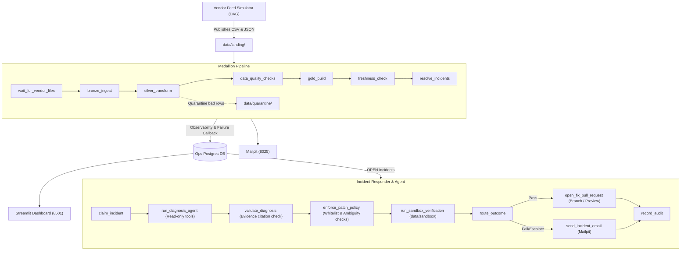

# PipelineSentinel Architecture

## System Overview
PipelineSentinel is designed to absorb transient failures autonomously through orchestrator backoff and retries, while utilizing an OpenAI tool-calling agent to diagnose deterministic format/schema drift failures. The agent proposes strict, sandbox-verified rules patches without possessing write access to any production environments.

