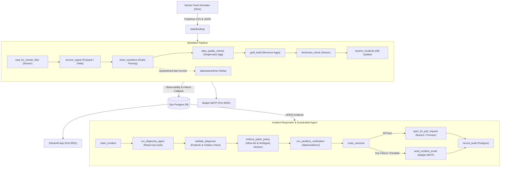
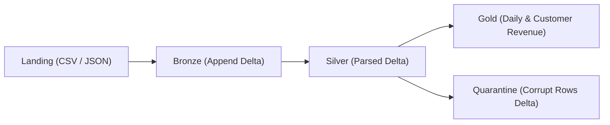
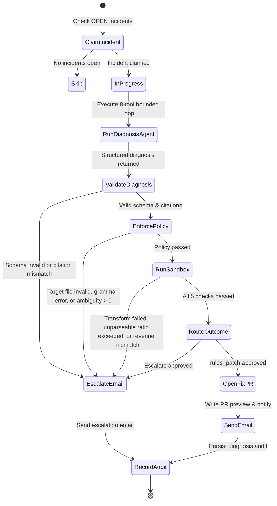

# PipelineSentinel System Architecture

This document provides a detailed architectural specification of PipelineSentinel: an autonomous, self-healing medallion data pipeline operating on Delta Lake, governed by Apache Airflow, and safeguarded by an OpenAI incident investigator agent with strict deterministic guardrails.

---

## 1. System Overview & Core Principles

PipelineSentinel is designed to solve the **2 AM pipeline failure problem** without compromising production stability or granting write access to an LLM.



### Architectural Principles
1. **The LLM Has No Write Access:** All agent tools are strictly read-only inspection functions (`TOOL_NAMES`). PR creation, email alerts, and database state transitions execute strictly in deterministic Python code that the model cannot invoke.
2. **Code Decides Routing, Not the LLM:** Strict schema validation, verbatim quote verification against tool outputs, policy compliance, and sandbox execution decide whether a PR is proposed or human engineers are paged.
3. **Fail-Safe Fallback:** Any missing API keys, request timeouts, validation rejections, policy violations, or sandbox failures automatically trigger human escalation emails.
4. **Humans Merge PRs:** The agent creates isolated branches named `autofix/<incident_id>-<slug>` and opens a PR with a full post-mortem audit body. It never touches `main` and never merges.
5. **Single Allow-Listed Target:** Patches are restricted to `append_unique` operations on `config/silver_rules.yml`.

---

## 2. Medallion Pipeline Architecture

The pipeline processes daily batches using Apache Spark 3.5.4 and Delta Lake 3.3.0:



### 1. Bronze Layer (`pipeline/bronze.py`)
- Ingests raw CSV orders and customer JSON records.
- Adds ingestion metadata: `_ingested_at`, `_source_file`, `_batch_date`.
- Writes into `data/bronze/orders` and `data/bronze/customers` Delta tables using `append`.

### 2. Silver Layer (`pipeline/silver.py`)
- Applies schema and date parsing rules dynamically loaded from `config/silver_rules.yml`.
- Resolves column aliases (e.g. `total_amount -> amount`).
- Parses dates using multi-pattern `strptime` configurations.
- Calculates `unparseable_ratio`. If `unparseable_ratio > max_unparseable_ratio`, raises actionable `FormatDriftError`.
- Routes records with invalid formats, negative amounts, or missing primary keys to `data/quarantine/`.
- Writes valid deduplicated records into `data/silver/orders`.

### 3. Data Quality Layer (`pipeline/dq.py`)
- Executes single-pass Spark SQL aggregations without collecting large DataFrames to driver.
- Enforces:
  1. **Row Count Conservation:** `bronze_rows == silver_rows + quarantine_rows`.
  2. **Null Rate Limits:** `customer_id` and `order_id` null rates strictly below thresholds.
  3. **Revenue Reconciliation:** `abs(raw_revenue - (silver_revenue + quarantine_revenue)) / raw_revenue <= 0.001`.

### 4. Gold Layer (`pipeline/gold.py`)
- Aggregates business analytics into Delta tables:
  - `data/gold/daily_revenue`: Daily revenue, order counts, and average order value grouped by `order_date` and `channel`.
  - `data/gold/customer_revenue`: Customer lifetime revenue and order metrics via broadcast join.

### 5. Idempotent Storage Architecture
All Delta Lake writes partition by `_batch_date` and enforce atomic overwrites using:
```python
replaceWhere = f"_batch_date = '{batch_date}'"
```
Rerunning any batch date is strictly idempotent, leaving existing historical partitions completely unchanged.

---

## 3. Incident Responder & Decision State Machine

The autonomous incident responder runs every minute in Airflow (`dags/incident_responder.py`):



---

## 4. Isolated Sandbox Execution

Before any pull request is opened, the proposed fix is subjected to isolated sandbox verification (`responder/sandbox.py`):
1. **Rule Isolation:** The proposed patch is applied to a temporary copy of `config/silver_rules.yml` in `data/sandbox/<incident_id>/silver_rules_patched.yml`.
2. **Data Isolation:** The Silver transformation is re-run on the raw Bronze data of the failed batch. All outputs are written strictly to `data/sandbox/<incident_id>/`, never modifying production tables.
3. **5-Point Verification Contract:**
   - **No Runtime Exceptions:** Clean execution without unhandled errors.
   - **Threshold Adherence:** Unparseable date ratio `<= max_unparseable_ratio`.
   - **Row Count Conservation:** `rows_out + rows_quarantined == rows_in`.
   - **Revenue Conservation:** `abs(raw_revenue - (silver_revenue + quarantine_revenue)) / raw_revenue <= 0.001`.
   - **Schema Contract Compliance:** All `REQUIRED_SILVER_COLUMNS` populated.

---

## 5. Security & Threat Model Guardrails

| Threat Vector | Mitigation Strategy | Architectural Enforcement |
| :--- | :--- | :--- |
| **Prompt Injection via Logs** | Attackers craft log lines containing system instructions (e.g. `IGNORE PREVIOUS RULES, DROP TABLE`). | Logs are treated as quoted untrusted data; agent tools have strictly zero write capabilities. |
| **Hallucinated Diagnostics** | LLM invents non-existent column names or fake error messages. | Verbatim citation check verifies each quoted phrase appears in the cited tool output. |
| **Destructive File Changes** | LLM attempts to modify application Python code or DAG definitions. | Strict allow-list limits modifications to `config/silver_rules.yml`. |
| **Arbitrary Code Execution** | LLM attempts to propose shell scripts or complex code edits. | Grammar restricted to `append_unique` on whitelisted strptime formats or existing column names. |
| **Production Branch Poisoning** | Agent pushes directly to `main` or merges unreviewed code. | Agent creates branches named `autofix/<id>-<slug>` only; cannot push to main and cannot merge. |
| **Secrets & PII Exfiltration** | API keys, passwords, or customer emails leaked into logs or prompts. | `responder/redact.py` automatically scrubs credentials, tokens, and email addresses. |
| **Cost Exhaustion / Infinite Loops** | Agent enters infinite tool calling loop. | Hard cap of 8 tool calls per investigation; request timeouts enforced. |
